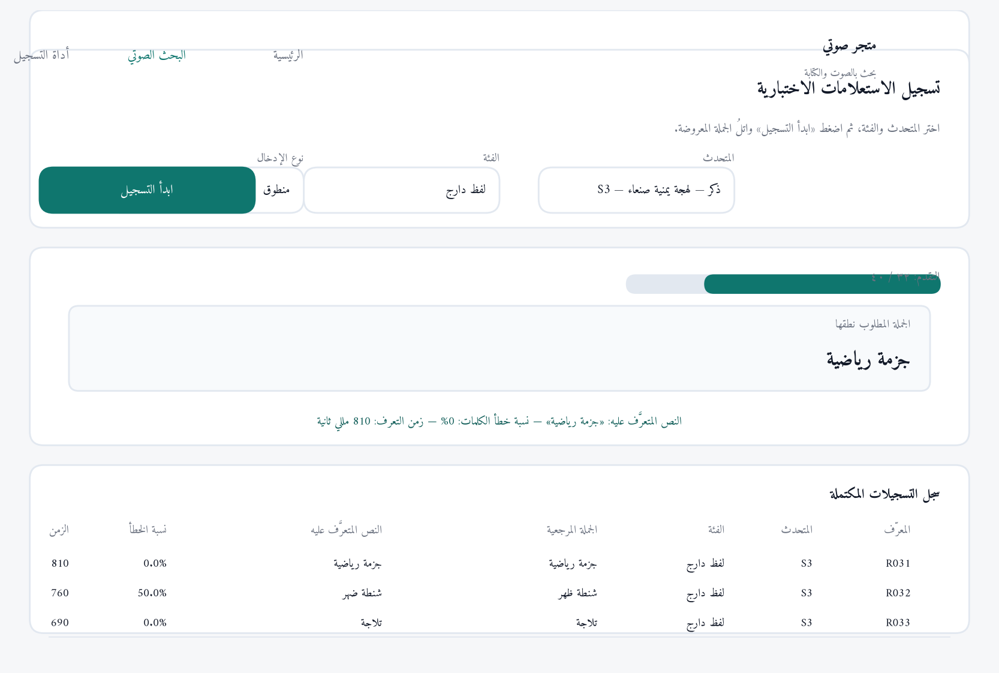
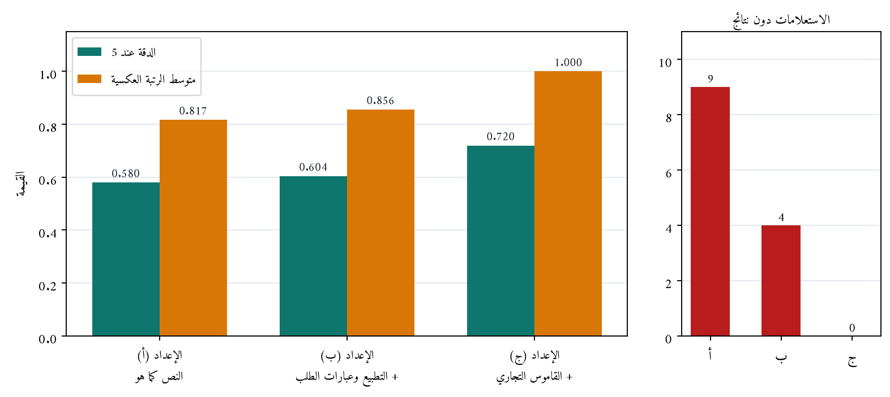
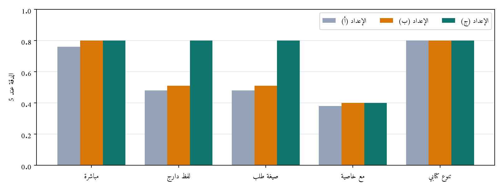
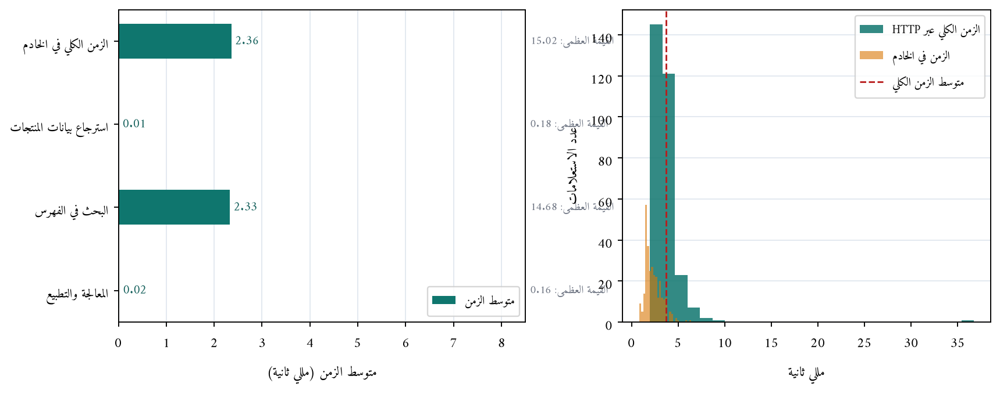

<div dir="rtl">

# الفصل الرابع: تنفيذ ونتائج البحث

## Implementation and Research Results

---

## 4.1 تمهيد (Introduction)

عرض الفصل الثالث تصميم محرك البحث الصوتي العربي القابل للدمج في منصات التجارة الإلكترونية: الطريقة المقترحة ومسار المعالجة السبعي، والبيانات المستخدمة، والمتطلبات الوظيفية وغير الوظيفية، والمعمارية الطبقية ونقاط التكامل الأربع، ومكونات الطريقة، وخوارزمية معالجة الاستعلام، ونمذجة البيانات والعمليات، وتصميم التجارب ومقاييس التقييم. وينتقل هذا الفصل من التصميم إلى التنفيذ الفعلي، فيعرض بيئة التنفيذ وأدواته، وبنية ملفات المشروع وتوزيعها على طبقات المعمارية، ثم ينفذ كل وحدة من وحدات الطريقة المقترحة كما وردت في القسم (6.3) بالضبط، ويعرض واجهات المستخدم ومدخلاتها وعملياتها ومخرجاتها، ثم يعرض التجارب الثلاث المعرَّفة في القسم (11.3) ونتائجها التفصيلية ومناقشتها، وينتهي بخاتمة الفصل.

وقد التُزم في هذا الفصل بالحدود والتقنيات الموثقة في الفصلين الأول والثاني حرفيًا: فالمحرك مبني بإطار Laravel 12 ولغة PHP، وقاعدة البيانات MySQL 8.4 مع Eloquent، ومحرك الفهرسة والبحث Meilisearch عبر Laravel Scout، وتحويل الكلام إلى نص بواجهة Web Speech API في المتصفح دون تدريب أي نموذج للتعرف على الكلام، والواجهة بلغات HTML وCSS وJavaScript، والمنصة المستضيفة متجر إلكتروني قائم مبني بإطار Laravel. ولم يُضف إلى المشروع أي تقنية خارج الجدول (2.1) في الفصل الأول، ولم يخرج التنفيذ عن الأهداف الفرعية الستة المعرَّفة في القسم (4.1) من الفصل الأول.

---

## 4.2 بيئة التنفيذ وأدواتها (Implementation Environment and Tools)

### 4.2.1 بيئة التطوير

نُفذ المحرك والمنصة المستضيفة على البيئة الموصوفة في الجدول (2.1) من الفصل الأول، وهي مجموعة الأدوات المادية والبرمجية نفسها التي بُني عليها المشروع، ويوضح الجدول (1.4) الإصدار الفعلي لكل أداة ودورها في التنفيذ.

**جدول (1.4): بيئة التنفيذ وإصدارات الأدوات المستخدمة**

| الأداة | الإصدار في التنفيذ | الدور في مرحلة التنفيذ |
| --- | --- | --- |
| PHP | 8.2 أو أحدث (متوافق مع 8.4) | تنفيذ طبقة التطبيق: وحدات التطبيع والقاموس والبحث |
| Laravel | 12.x | إطار عمل المنصة المستضيفة وبنية المحرك |
| Laravel Scout | 10.x | ربط نموذج المنتج بمحرك البحث ومزامنة الفهرس |
| Meilisearch | 1.x | فهرسة بيانات المنتجات وتنفيذ البحث وترتيب النتائج |
| MySQL | 8.4 | تخزين بيانات المتجر والقواميس وجدول القاموس التجاري |
| Composer | 2.x | إدارة حزم PHP |
| Google Chrome | الإصدار الحديث | تشغيل الواجهة وتنفيذ التعرف على الكلام |
| Web Speech API | الواجهة القياسية | تحويل الكلام العربي إلى نص في المتصفح |
| Git / GitHub | 2.x | إدارة الشيفرة وتتبع التعديلات |
| VS Code / draw.io | — | البرمجة وإعداد مخططات الفصل الثالث |

ويُشغَّل المحرك بأربعة أوامر متسلسلة تُنفذ عند تهيئة بيئة العمل: تثبيت الحزم، ثم ترحيل الجداول وتعبئتها بالبيانات، ثم إرسال إعدادات الفهرس إلى Meilisearch، ثم فهرسة المنتجات. وتُدمج هذه الأوامر في سكربت واحد لتسهيل إعادة بناء البيئة كما يأتي:

```bash
composer install
php artisan migrate --seed
php artisan search:index-settings      # إعدادات الفهرس (الجدول 10.3)
php artisan search:index-products --flush  # فهرسة المنتجات عبر Laravel Scout
php artisan serve                      # تشغيل المتجر والمحرك
```

### 4.2.2 الأثر الملموس للأدوات في التنفيذ

لم تُختَر هذه الأدوات اختيارًا عشوائيًا وإنما وُظفت في مواضع محددة من التنفيذ، فحقق كل منها جزءًا من المتطلبات:

- **Laravel 12**: وفر التوجيه (Routing) لتعريف نقاط التكامل الأربع، والتحقق من المدخلات في `SearchRequest`، وإرجاع الاستجابات بصيغة JSON، وإدارة الترحيلات (Migrations) التي تُنشئ جدول القاموس التجاري بملف واحد.
- **Laravel Scout**: حقق وظيفتين محددتين: الفهرسة التلقائية عند إضافة المنتجات أو تعديلها أو حذفها (المتطلب FR-08)، وإرسال إعدادات الفهرس (الحقول المفهرسة والمرادفات والتسامح مع الأخطاء) بأمر واحد.
- **Meilisearch**: نفذ المطابقة الفعلية والترتيب بحسب الصلة والتسامح مع الأخطاء الإملائية وتطبيق المرادفات المتكافئة وإسقاط الكلمات من آخر الاستعلام، وهي الوظائف التي كان يعاد بناؤها لو استُخدمت مطابقة SQL التقليدية.
- **Web Speech API**: حلّت مشكلة تحويل الكلام العربي إلى نص دون تطوير نموذج تعرف أو تدريبه، وهو الحد الذي رسمه القسم (6.1) من الفصل الأول صراحةً.
- **MySQL وEloquent**: وفّرتا قراءة بيانات المنتجات وخصائصها دون تعديل بنية جداول المتجر، وهو ما يحقق متطلب قابلية الدمج (NFR-02).

---

## 4.3 بنية ملفات التنفيذ (Implementation Structure)

وُزعت ملفات التنفيذ على المعمارية الطبقية الأربع المعروضة في الشكل (3.3) من الفصل الثالث، بحيث يقابل كل مكوّن من مكونات الطريقة المقترحة ملفًا أو أكثر، ويُبنى الربط بينها بواسطة حاوية الخدمات في Laravel (Service Container) لا بالاستدعاء المباشر، فيمكن اختبار كل وحدة على حدة واستبدالها دون التأثير في بقية المحرك. ويوضح الشكل (1.4) بنية الملفات، ويبين الجدول (2.4) مقابلة كل مكوّن بملفه ونقطته المقابلة في الفصل الثالث.


**جدول (2.4): مقابلة مكونات التصميم بملفات التنفيذ**

| مكوّن التصميم (الفصل الثالث) | ملف التنفيذ | المسؤولية |
| --- | --- | --- |
| وحدة الإدخال الصوتي (1.6.3) | `js/voice-search.js` في المجلد `public` | تهيئة Web Speech API، وضبط lang وcontinuous وinterimResults، وقياس زمن التعرف |
| وحدة التطبيع (2.6.3) | `Search/Normalizer.php` | تنفيذ قواعد التطبيع السبع في الجدول (7.3) |
| حذف عبارات الطلب (2.6.3) | `Search/StopPhraseFilter.php` | حذف عبارات الجدول (8.3) مع شرط عدم إفراغ الاستعلام |
| وحدة القاموس التجاري (3.6.3) | `Search/Lexicon.php` | المطابقة الأطول أولًا، وتوليد إعداد المرادفات من علاقات التكافؤ |
| معالجة الاستعلام | `Search/QueryProcessor.php` | تنفيذ الخطوات 2 إلى 6 من الخوارزمية (1.3) |
| وحدة البحث والفهرسة (4.6.3) | `Search/SearchService.php` و `Search/IndexSettings.php` | تنفيذ البحث عبر Scout وإرسال إعدادات الجدول (10.3) |
| وحدة الاسترجاع والعرض (5.6.3) — أولًا | `Controllers/SearchController.php` | استرجاع السجلات بترتيب الصلة وإعادة النتائج بصيغة JSON |
| وحدة الاسترجاع والعرض (5.6.3) — ثانيًا | `Resources/ProductResource.php` | صياغة كل نتيجة بالحقول الستة المعروضة |
| نموذج المنتج (نقطة التكامل 3) | `Models/Product.php` | سمة `Searchable` ودالة `toSearchableArray` لتحديد الحقول المفهرسة |
| جدول القاموس (نقطة التكامل 4) | ملف الترحيل الخامس في `database/migrations` | إنشاء جدول `lexicon_entries` وحقوله الأربعة |
| مسار API (نقطة التكامل 2) | `routes/api.php` | `POST /api/voice-search` |
| التجارب الثلاث | أوامر التجارب في `Console/Commands` | تشغيل التجارب وحساب المقاييس وحفظ النتائج |

وقد رُوعي في التوزيع أن الوحدة المركزية في التصميم — وهي طبقة المعالجة — تبقى في مجلد واحد باسم `Search` داخل مجلد التطبيق، فلا تتفرق قواعد التطبيع والقاموس في ملفات متعددة، فيسهل تتبع كل قاعدة إلى الجدول الذي عرّفها في الفصل الثالث. أما المسارات الكاملة للملفات فهي مبيَّنة في الجدول (23.4).

---

## 4.4 تنفيذ الوحدات (Modules Implementation)

### 4.4.1 وحدة الإدخال الصوتي (Voice Input Module)

نُفذت هذه الوحدة في الملف `public/js/voice-search.js` مقابلةً للقسم (1.6.3) من الفصل الثالث، وتعمل بثلاث خطوات مرتبة:

**الخطوة الأولى — التحقق من دعم المتصفح (المتطلب FR-13):** عند تحميل صفحة البحث تُفحص الواجهة `SpeechRecognition` أو بديلها المسبوق ببادئة المتصفح `webkitSpeechRecognition`، فإن توفرت أُظهر زر الميكروفون، وإلا بقي مخفيًا وظهر للمستخدم تنبيه بأن الإدخال النصي متاح كما في الشكل (4.4).

```javascript
const SpeechRecognitionImpl = window.SpeechRecognition || window.webkitSpeechRecognition;
const supported = typeof SpeechRecognitionImpl === 'function';
if (supported) { micButton.hidden = false; }
else { micButton.hidden = true; showMessage('متصفحك لا يدعم الإدخال الصوتي…', 'info'); }
```

**الخطوة الثانية — ضبط خصائص التعرف وبدؤه (المتطلبات FR-01 وFR-03):** تُبنى نسخة التعرف وتُضبط خصائصها الأربع كما وردت في التصميم نصًا: اللغة `lang = 'ar-SA'`، و`continuous = false` لينتهي التعرف بانتهاء جملة المستخدم، و`interimResults = false` لاستلام النص النهائي فقط، و`maxAlternatives = 1` لقراءة البديل الأول.

```javascript
const instance = new SpeechRecognitionImpl();
instance.lang = language;          // ضبط لغة التعرف على العربية
instance.continuous = false;       // ينتهي التعرف بانتهاء الجملة
instance.interimResults = false;   // النص النهائي فقط
instance.maxAlternatives = 1;      // يُقرأ النص من البديل الأول
```

**الخطوة الثالثة — التعامل مع الأحداث (المتطلبات FR-03 وFR-12 والتجربة الثالثة):** عند الحدث `result` يُقرأ النص من البديل الأول ويُرسل إلى الخادم، وعند الحدث `speechend` يُسجَّل التوقيت لحساب زمن التعرف على الكلام، وعند `error` تُعرض رسالة توضح سببه من قائمة رسائل معرَّفة (`no-speech`، `audio-capture`، `not-allowed`، `network`، `aborted`).

**جدول (3.4): رسائل الحالات الاستثنائية في وحدة الإدخال الصوتي، وربطها بالمتطلبات**

| الحدث أو الحالة | رمز الخطأ من الواجهة | الرسالة المعروضة للمستخدم | المتطلب |
| --- | --- | --- | --- |
| لم يُلتقط كلام | `no-speech` | لم يُلتقط أي استعالم، يُرجى إعادة المحاولة والتحدث بوضوح. | FR-12 |
| لا يوجد ميكروفون | `audio-capture` | لم يُعثر على ميكروفون متصل بالجهاز. | FR-12 |
| رفض إذن الميكروفون | `not-allowed` | لم يُمنح إذن استخدام الميكروفون، يُرجى السماح به من إعدادات المتصفح. | FR-12 |
| انقطاع خدمة التعرف | `network` | تعذر الوصول إلى خدمة التعرف على الكلام، تأكد من اتصال الإنترنت. | FR-12 |
| إيقاف الاستماع يدويًا | `aborted` | أُوقف الاستماع قبل التقاط الاستعالم. | FR-12 |
| متصفح غير داعم | — | متصفحك لا يدعم الإدخال الصوتي… (مع بقاء الحقل النصي) | FR-13 |
| لا توجد نتائج مطابقة | — | لا توجد منتجات مطابقة لاستعلامك، جرّب كلمات أخرى. | FR-12 |

### 4.4.2 وحدة التطبيع وحذف عبارات الطلب (Normalization Module)

**أولًا: التطبيع.** نُفذ في الصنف `app/Search/Normalizer.php` بالقواعد السبع نفسها وبالترتيب نفسه الوارد في الجدولين (7.3) من الفصل الثالث و(7.3) من هذا الفصل، وتُطبق الدالة `normalize()` على استعلام المستخدم وعلى وثيقة الفهرسة وعلى مداخل القاموس معًا، فتُقارن الكلمات في الأطراف الثلاثة بصيغة موحدة. ويعرض الجدول (4.4) تعبير التنفيذ المقابل لكل قاعدة، وهو الجدول الذي يوثق الانتقال من القاعدة المصممة إلى الشيفرة المنفذة.

**جدول (4.4): قواعد التطبيع وتعبير التنفيذ المقابل لها**

| القاعدة (الجدول 7.3) | قبل | بعد | تعبير التنفيذ |
| --- | --- | --- | --- |
| حذف التشكيل | حَقِيبَة | حقيبة | `preg_replace(self::DIACRITICS, '', $text)` |
| حذف التطويل | حقيـبة | حقيبة | ضمن `DIACRITICS` في النطاق `\x{0640}` |
| توحيد الألف المهموزة (أ، إ، آ) إلى ا | أسود | اسود | `preg_replace('/[\x{0623}\x{0625}\x{0622}\x{0671}]/u', 'ا', $text)` |
| تحويل التاء المربوطة في آخر الكلمة إلى ه | حقيبة | حقيبه | فحص آخر حرف في كل كلمة: `mb_substr($word, -1) === 'ة'` |
| تحويل الألف المقصورة في آخر الكلمة إلى ي | حلوى | حلوي | فحص آخر حرف في كل كلمة: `mb_substr($word, -1) === 'ى'` |
| توحيد الأرقام الهندية إلى الأرقام العربية | ٢٤ | 24 | `preg_replace_callback` على النطاقين `\x{0660}-\x{0669}` و`\x{06F0}-\x{06F9}` |
| حذف علامات الترقيم وتوحيد المسافات | !حقيبة، ظهر | حقيبة ظهر | `PUNCTUATION` ثم `preg_replace('/\s+/u', ' ', $text)` |

وقد رُوعي في التنفيذ شرطان مهمان: أن تُحوَّل التاء المربوطة والألف المقصورة في **آخر الكلمة** فقط، فلا تُحوَّل مثلًا تاء «فاطمة» إلى هاء؛ وأن تُعالج الأرقام الهندية والفارسية معًا لأن كليهما يرد في النصوص العربية، كما في قيم خصائص المتجر مثل «٣ مل» و«١٢ قدم».

**ثانيًا: حذف عبارات الطلب.** نُفذ في الصنف `app/Search/StopPhraseFilter.php` اعتمادًا على ملف `resources/data/stop_phrases.txt` الذي يحوي 22 عبارة موزعة على الأصناف الأربعة في الجدول (8.3)، وتُقرأ العبارات وتُطبَّع مرة واحدة عند بناء الخدمة لتوافق نص الاستعلام المطبَّع. ويعرض الجدول (5.4) العبارات المنفذة فعليًا في كل صنف.

**جدول (5.4): عبارات الطلب المنفذة في ملف `stop_phrases.txt`**

| الصنف (الجدول 8.3) | العبارات المنفذة | العدد |
| --- | --- | --- |
| أفعال الطلب | أريد، أبغى، أبي، أريد، أحتاج، ودي | 6 |
| عبارات البحث | ابحث عن، ابحث لي، دور لي، شوف لي، أعطني، هات لي | 6 |
| عبارات التأدب | لو سمحت، من فضلك، الله يعافيك | 3 |
| أدوات السؤال | هل، عندكم، عندك، يوجد، ممكن | 5 |
| أفعال وصيغ إضافية وردت في اختبار الاستعلامات | بدي، أبحث | 2 |

ويُطبَّق الحذف بكلمتين أولًا ثم بكلمة واحدة، تنفيذًا لقاعدة التصميم القائلة بحذف العبارة من كلمتين قبل حذف الكلمات المفردة. ويُنفذ شرط الحماية في نهاية الدالة:

```php
return $kept === [] ? array_values($words) : array_values($kept);
```

فإذا كان حذف عبارات الطلب سيُفرغ الاستعلام، يُعاد الاستعلام الأصلي كما هو، فلا يُرسل إلى البحث استعلام فارغ، وهو الشرط المنصوص عليه في الخطوة 4 من الخوارزمية (1.3). وقد تحققت هذه الحالة في اختبار الوحدة `StopPhraseFilterTest::test_keeps_query_when_removal_would_empty_it` باستعلام «هل عندكم» فبقي كما هو.

### 4.4.3 وحدة القاموس التجاري (Lexicon Module)

نُفذت في الصنف `app/Search/Lexicon.php` مع جدول القاعدة `lexicon_entries` المنشأ بملف الترحيل الخامس، ونُفذت بثلاث وظائف مرتبة:

**الوظيفة الأولى — بناء القاموس من قاعدة البيانات:** يُبنى القاموس مرة واحدة عند أول طلب ويُخزَّن في ذاكرة التخزين المؤقت للتطبيق (`Cache::rememberForever('lexicon_entries')`)، فلا تُقرأ القاعدة في كل استعلام، وتُفرَّغ الذاكرة عند تحديث القاموس بأمر `lexicon:import` عبر الدالة `forget()`. ويحقق ذلك المتطلب NFR-05 (قابلية الصيانة) لأن تحديث القاموس يقع ببيانات الجدول دون تعديل الشيفرة.

**الوظيفة الثانية — الاستبدال بالمطابقة الأطول أولًا (المتطلب FR-06):** يبحث التطبيق في العبارات المكونة من كلمتين أولًا، فإن وجد المدخل استبدله وتخطى الكلمة التالية، ثم انتقل إلى الكلمات المفردة، وهو الترتيب المنصوص عليه في القسم (3.6.3).

```php
for ($i = 0; $i < $count; $i++) {
    $pair = $i + 1 < $count ? $words[$i] . ' ' . $words[$i + 1] : null;
    if ($pair !== null && isset($this->substitutions[$pair])) { /* استبدال العبارة من كلمتين */ }
    if (isset($this->singleWord[$words[$i]])) { /* استبدال الكلمة المفردة */ }
}
```

**الوظيفة الثالثة — توليد إعداد المرادفات من علاقات التكافؤ:** تُجمع أزواج التكافؤ في مجموعات مغلقة (بنية اتحاد-بحث Union-Find)، ثم يُبنى إعداد `synonyms` بحيث يشير كل مصطلح إلى بقية أعضاء مجموعته، وهو الإعداد الذي يُرسل إلى Meilisearch في الجدول (10.3). وبهذا يتحقق الفصل المنصوص عليه في التصميم: علاقات الاستبدال تُعالجها وحدة القاموس في الخادم، وعلاقات التكافؤ يعالجها Meilisearch عند البحث.

**جدول (6.4): القاموس التجاري المنفذ وتركيبه**

| البند | العدد المنفذ | أمثلة منفذة |
| --- | --- | --- |
| مداخل الاستبدال أحادي الاتجاه | 58 | شنطة ← حقيبة، جزمة ← حذاء، موبايل ← هاتف، لابتوب ← حاسوب محمول، كندشن ← مكيف سبليت، بلندر ← خلاط كهربائي |
| مداخل التكافؤ المتبادل | 9 | كنبة ↔ أريكة، قنفة ↔ أريكة، هاتف ذكي ↔ هاتف، عباية ↔ عبايا، طرحة ↔ حجاب |
| مداخل استبدال من كلمتين (تُطابق قبل المفردة) | 15 | شنطة ظهر، شنطة يد، جزمة رياضية، لابتوب اتش بي، كرسي شغل |
| صيغ المؤنث للألوان المضافة للاستعلامات الوصفية | 9 | سوداء ← أسود، حمراء ← أحمر، رمادية ← رمادي، فضية ← فضي |
| الإجمالي | 67 | — |

وقد استُخرجت الأطراف المعتمدة في كل مدخل من أسماء المنتجات وفئاتها الفعلية في المتجر المستضيف، كما هو مشروط في القسم (2.3.3)، فليس في القاموس مدخل يقابل مصطلحًا غير موجود في البيانات؛ وتحققت هذه المقابلة آليًا عند بناء مجموعة البيانات، وكانت نتيجة الفحص أن جميع الأطراف المعتمدة الـ67 موجودة في نصوص المنتجات وخصائصها.

### 4.4.4 وحدة البحث والفهرسة (Search and Indexing Module)

**أولًا: بناء وثيقة الفهرسة.** حُددت الحقول المفهرسة في `toSearchableArray()` في نموذج المنتج، وهي الحقول الخمسة الأولى في الجدول (1.3): الاسم، الفئة، قيم الخصائص، الوصف، مع المعرّف؛ وتُطبق عليها قواعد التطبيع نفسها قبل إرسالها إلى الفهرس، وتُستثنى من الفهرسة السعر والصورة وحالة التوفر لأنها لا تُستخدم في المطابقة وتُسترجع من MySQL عند العرض. ويعرض الجدول (7.4) وثيقة فهرسة فعلية لمنتج من البيانات المنفذة.

**جدول (7.4): وثيقة فهرسة منتج فعلي في البيانات المنفذة (المنتج رقم 1)**

| الحقل | القيمة في قاعدة البيانات | القيمة في الفهرس بعد التطبيع | مفهرس؟ |
| --- | --- | --- | --- |
| id | 1 | 1 | نعم (معرّف الوثيقة) |
| name | حقيبة ظهر جلدية | حقيبه ظهر جلديه | نعم |
| category | الحقائب | الحقائب | نعم |
| attributes | أسود | اسود | نعم |
| description | حقيبة ظهر جلدية بجيوب متعددة وحزام كتف مريح… | حقيبه ظهر جلديه بجيوب متعدده وحزام كتف مريح… | نعم |
| price | 13000 | — | لا (يُعرض من MySQL) |
| image | images/products/cat01.svg | — | لا (يُعرض من MySQL) |
| stock | 35 | — | لا (يُعرض من MySQL) |

**ثانيًا: إعدادات الفهرس.** نُفذت في الصنف `app/Search/IndexSettings.php` وتُرسل إلى Meilisearch بالأمر `search:index-settings`، ويطابق كل إعداد منها ما ورد في الجدول (10.3) كما يوضح الجدول (8.4).

**جدول (8.4): إعدادات فهرس المنتجات في التصميم وفي التنفيذ**

| الإعداد | القيمة في التصميم (الجدول 10.3) | القيمة المنفذة | موضع التنفيذ |
| --- | --- | --- | --- |
| searchableAttributes | الاسم، الفئة، قيم الخصائص، الوصف | `['name', 'category', 'attributes', 'description']` | `IndexSettings::SEARCHABLE_ATTRIBUTES` و`config/scout.php` |
| synonyms | علاقات التكافؤ بصيغتها المطبَّعة | 17 مصطلحًا مستخرجة من 9 علاقات تكافؤ | `Lexicon::synonymsSetting()` |
| typoTolerance | الإعداد الافتراضي | خطأ واحد من 5 أحرف، وخطآن من 9 أحرف | `IndexSettings::toArray()` |
| matchingStrategy | `last` | `last` | `IndexSettings::MATCHING_STRATEGY` |

وأما ترتيب الحقول في `searchableAttributes` فهو الذي يحكم قاعدة الترتيب `attribute` في Meilisearch، فتقدم المنتجات التي وردت كلمات الاستعلام في حقل الاسم على التي وردت في الفئة، وهذه على التي وردت في الوصف. ولذلك ظهر في نتائج التجربة الثانية أن الاستعلام «حقيبة ظهر جلدية سوداء» قدّم المنتجين الأسودين (المعرّفان 1 و2) على المنتج البني (المعرّف 3) لأن كلمة «سوداء» بعد تطبيعها إلى «اسود» وردت في حقل قيم الخصائص لأولهما، وهو التحقق العملي للحالة TC-06.

**ثالثًا: تنفيذ البحث والاسترجاع.** نُفذت الخطوتان 7 و9 من الخوارزمية (1.3) في الصنف `app/Search/SearchService.php`:

```php
$processed = $this->processor->process($rawQuery, $setting);          // الخطوات 2 إلى 6
$products  = Product::search($processed['query'])->take($limit)->get(); // الخطوتان 7 و9 عبر Scout
```

و`Product::search()` تنقل الاستعلام إلى Meilisearch وتعيد معرّفات المنتجات مرتبة بحسب قواعد الترتيب، ثم يجلب Scout سجلاتها من جدول المنتجات بالترتيب نفسه، فتبقى الأسعار والصور وحالة التوفر بقيمها الحالية في المتجر لحظة العرض. ويُقاس زمن كل مرحلة داخل الخدمة وتُعاد قيمه مع الاستجابة لاستخدامها في التجربة الثالثة:

```php
'timing_ms' => [
    'processing'   => $ms($startedAt, $afterProcessing),  // التطبيع وحذف عبارات الطلب والقاموس
    'search'       => $ms($afterProcessing, $afterSearch), // البحث في Meilisearch
    'retrieval'    => $ms($afterSearch, microtime(true)),  // الاسترجاع من MySQL وإعداد الاستجابة
    'server_total' => $ms($startedAt, microtime(true)),    // الزمن الكلي في الخادم
],
```

**رابعًا: مزامنة الفهرس (المتطلب FR-08).** تُنفذ المزامنة تلقائيًا بواسطة Laravel Scout: فإضافة منتج أو تعديله أو حذفه في قاعدة البيانات تُحدِّث الوثيقة المقابلة في الفهرس دون أمر يدوي، ويُبنى الفهرس ابتداءً بالأمر `search:index-products`. وقُيست هذه المزامنة في الحالة TC-10 حيث عُدِّل اسم منتج فتغيّرت وثيقة فهرسته فورًا.

### 4.4.5 وحدة الاسترجاع والعرض (Retrieval and Display Module)

نُفذت في متحكم البحث `app/Http/Controllers/SearchController.php` وفي مورد العرض `app/Http/Resources/ProductResource.php`، ويعيد المتحكم لكل منتج الحقول الستة المنصوص عليها في القسم (5.6.3): المعرّف، والاسم، والفئة، وقيم الخصائص، والسعر، ورابط الصورة، وحالة التوفر، ورابط صفحة المنتج في المتجر. ويُعيد الاستجابة بالبنية الآتية:

```json
{
  "query": "حقيبه ظهر اسود",
  "stages": {
    "raw": "أبغى شنطة ظهر سوداء لو سمحت",
    "normalized": "ابغي شنطه ظهر سوداء لو سمحت",
    "after_stop_phrases": "شنطه ظهر سوداء",
    "after_lexicon": "حقيبه ظهر اسود"
  },
  "replacements": [
    {"from": "شنطه ظهر", "to": "حقيبه ظهر"},
    {"from": "سوداء", "to": "اسود"}
  ],
  "count": 12,
  "products": [ {"id": 1, "name": "حقيبة ظهر جلدية", "price": 13000, "available": true, "url": "…"} ],
  "message": null,
  "timing_ms": {"processing": 0.03, "search": 2.43, "retrieval": 0.01, "server_total": 2.47}
}
```

وقد أُضيفت في التنفيذ ثلاثة حقول خدمية لم تكن في التصميم الأدنى ولم تخالفه: `stages` الذي يعرض نص الاستعلام في كل مرحلة، و`replacements` الذي يعرض عمليات استبدال القاموس التي وقعت فعلًا، و`timing_ms` الذي يعرض أزمنة المراحل. وهذه الحقول تحقق غرضين: أنها تجعل سلوك المحرك مرئيًا قابلًا للتحقق في الواجهة، وأنها البيانات التي تُبنى عليها التجربتان الثانية والثالثة.

---

## 4.5 تنفيذ نقاط التكامل مع المنصة المستضيفة (Integration Points Implementation)

نُفذت نقاط التكامل الأربع المعرَّفة في القسم (2.5.3) من الفصل الثالث، ويبين الجدول (9.4) ما نُفذ في كل نقطة وموضعها في الشيفرة.

**جدول (9.4): تنفيذ نقاط التكامل الأربع**

| النقطة | ما نُفذ | موضع التنفيذ | الأثر في المتجر المستضيف |
| --- | --- | --- | --- |
| الأولى: مكوّن الواجهة | زر الميكروفون وشيفرة JavaScript المرتبطة به | `public/js/voice-search.js` + وسم الزر في صفحة البحث | سطران في صفحة البحث: وسم الزر ووسم السكربت |
| الثانية: مسار API | مسار واحد يستقبل نص الاستعلام ويعيد النتائج | `routes/api.php` → `POST /api/voice-search` | مسار واحد، لا تعديل في مسارات المتجر القائمة |
| الثالثة: نموذج المنتج | إضافة `Searchable` وتعريف `toSearchableArray` | `app/Models/Product.php` | إضافة سمة ودالة إلى النموذج القائم، دون تغيير الجدول |
| الرابعة: جدول القاموس | إنشاء جدول `lexicon_entries` بملف ترحيل واحد | الترحيل الخامس + الأمر `lexicon:import` | جدول مستقل لا يرتبط بجداول المتجر بعلاقات خارجية |

والدليل العملي على أن التكامل لم يغيّر بنية بيانات المتجر أن جداول المتجر الأربعة (`categories`، `attributes`، `products`، `attribute_values`) أُنشئت في بيئة التجربة على البنية الموصوفة في القسم (1.3.3) والشكل (5.3)، ولم تُضف إليها أي أعمدة من المحرك، وأن الحقول المفهرسة تُجمَّع من هذه الجداول داخل `toSearchableArray` وحدها. ويعرض الجدول (10.4) وصف جدول القاموس المنفذ ومقارنته بالجدول (11.3) في التصميم.

**جدول (10.4): جدول القاموس التجاري `lexicon_entries` في التصميم وفي التنفيذ**

| الحقل | النوع في التصميم (الجدول 11.3) | النوع المنفذ في الترحيل | ملاحظات التنفيذ |
| --- | --- | --- | --- |
| id | عدد صحيح | `id` (مفتاح أساسي تلقائي) | — |
| term | نص | `string(120)` | اللفظ كما يُكتب عادة |
| normalized_term | نص | `string(120)` مع قيد `unique` | يُستخدم في المطابقة، ويُولَّد بالتطبيع عند الاستيراد |
| canonical_term | نص | `string(120)` | المصطلح المعتمد بصيغته المطبَّعة |
| relation_type | قيمة من قائمة | `enum('substitution','equivalence')` | قائمة مقيدة بقيمتين، لا ثالث لهما |

وقد أُضيف قيد التفرّد على `normalized_term` وفهرس على `relation_type` دعمًا للأداء وسلامة البيانات، وهما إضافتان لا تخالفان التصميم لأنهما يقيدان الجدول ولا يوسعان وظيفته.

---

## 4.6 واجهات المستخدم ومدخلاتها وعملياتها ومخرجاتها (User Interfaces)

### 4.6.1 واجهة البحث الصوتي

تُعرض واجهة البحث في المسار `/search` من المتجر، وتضم: عنوانًا إرشاديًا، وحقل الإدخال النصي، وزر الميكروفون، وزر البحث، وشريط حالة الاستماع، ومنطقة عرض مراحل المعالجة، وشبكة النتائج. ويعرض الشكل (2.4) الواجهة بعد تنفيذ استعلام منطوق.


**المدخلات:** نص الاستعلام، ويأتي من مصدرين: الصوت عبر Web Speech API (المتطلب FR-01)، أو الكتابة في الحقل النصي (المتطلب FR-02)، وكلاهما يمر بمسار المعالجة نفسه تحقيقًا لتصميم القسم (2.3).

**العمليات:** عند الإرسال يُنفَّذ طلب `POST /api/voice-search` على ثلاث مراحل داخل الخادم: التطبيع وحذف عبارات الطلب، ثم تطبيق القاموس التجاري، ثم البحث في الفهرس واسترجاع السجلات.

**المخرجات:** تُعرض لكل منتج صورة واسم وفئة وقيم الخصائص والسعر وحالة التوفر ورابط صفحة المنتج، ويُعرض قبلها عدد النتائج وزمن المعالجة في الخادم، ويُعرض تحت الحقل شريط مراحل المعالجة الذي يوضح نص الاستعلام في كل مرحلة وما جرى عليه من استبدال، كما يوضح الشكل (9.4) في القسم (4.10.3). وتظهر حالة الاستماع كما في الشكل (3.4) حيث يُضاء زر الميكروفون ويظهر التنبيه حتى انتهاء الجملة.


### 4.6.2 واجهات الحالات الاستثنائية

نُفذت الحالات الأربع المنصوص عليها في المتطلب FR-12 كما يوضح الشكل (4.4): عدم التقاط كلام، وعدم وجود منتجات مطابقة، ومتصفح لا يدعم التعرف على الكلام، وتعذر تنفيذ البحث. وفي جميعها لا تُفرَّغ نتائج الاستعلام السابق فجأة ولا يظهر خطأ تقني للمستخدم، وإنما تظهر رسالة عربية واضحة تحدد السبب والإجراء.


### 4.6.3 واجهة أداة تسجيل الاستعلامات الاختبارية

تُعرض في المسار `/tools/recordings`، وهي أداة عمل أُنشئت لتنفيذ التجربتين الأولى والثالثة وفق ما ورد في القسم (3.3.3): تعرض الأداة الجملة المرجعية على المتحدث المختار، فتبدأ التعرف على الكلام عند الضغط على الزر، وتحسب نسبة خطأ الكلمات مباشرة بعد التقاط النص، وتحفظ نتيجة كل تسجيل في الخادم وفي ملف يُنزَّل من المتصفح. ويعرض الشكل (5.4) الأداة وهي تعرض التقدم في مجموعة المتحدث الثالث (40 استعلامًا).



**المدخلات:** اختيار المتحدث (خمسة متحدثين)، واختيار فئة الاستعلامات الأربع المنطوقة، واختيار نوع الإدخال (منطوق أو مكتوب)، ثم نطق الجملة أو كتابتها في الفئة الخامسة.

**العمليات:** تُبنى قائمة انتظار الاستعلامات للمتحدث المختار من قائمة التسجيلات المطلوبة (400 تسجيل = 80 استعلامًا منطوقًا × 5 متحدثين)، ويُقاس زمن التعرف من الحدث `speechend` إلى الحدث `result`، وتُحسب نسبة خطأ الكلمات، ويُحفظ التسجيل بالـ `POST /api/recordings` في الملف `storage/app/experiments/recordings_results.csv`.

**المخرجات:** جدول التسجيلات المكتملة الذي يعرض المعرّف والمتحدث والفئة والجملة المرجعية والنص المتعرَّف عليه ونسبة خطأ الكلمات وزمن التعرف، وملف `recordings_results.csv` الذي يُستخدم مباشرة في الأمر `search:experiment-wer`.

**حماية خصوصية المتحدث (المتطلب NFR-06):** لا يُحفظ الصوت في أي مرحلة؛ فالتسخير الصوتي وخدمة التعرف على الكلام في المتصفح لا يُبقيان في التطبيق أثرًا، ولا يُخزَّن في قاعدة البيانات ولا في الملفات إلا **النص** الناتج عن التعرف وزمنه، وهو ما ينص عليه المتطلب صراحةً: «عدم حفظ صوت المستخدم أو نصوص استعلاماته في قاعدة البيانات». أما نصوص الاستعلامات المحفوظة في ملف التجارب فهي النصوص المرجعية المعِدّة مسبقًا في مجموعة الاختبار لا استعلامات مستخدمين حقيقيين، وتُستخدم لأغراض التقييم الأكاديمي فقط.

---

## 4.7 التجارب (Experiments)

### 4.7.1 أداة تنفيذ التجارب

نُفذت التجارب الثلاث بأوامر مستقلة في `app/Console/Commands`، بحيث يمكن إعادة تشغيلها على أي متجر آخر بالبيانات نفسها، ويبين الجدول (11.4) الأمر المقابل لكل تجربة.

**جدول (11.4): أوامر تنفيذ التجارب ومخرجاتها**

| التجربة | الأمر | مخرجات الملفات |
| --- | --- | --- |
| الثانية: ملاءمة النتائج | `php artisan search:experiment-relevance --source=both` | `docs/results/experiment2_relevance.json` و`.csv` |
| الثالثة: زمن الاستجابة | `php artisan search:experiment-latency --runs=3` | `docs/results/experiment3_latency.json` |
| الأولى: نسبة خطأ الكلمات | `php artisan search:experiment-wer` | `docs/results/experiment1_wer.json` و`.csv` |

### 4.7.2 التجربة الأولى: دقة تحويل الكلام إلى نص

**إجراء التجربة كما ورد في القسم (3.11.3):** ينطق كل متحدث من المتحدثين الخمسة استعلامات الفئات الأربع الأولى (80 استعلامًا)، فيتكون 400 تسجيل، وتُحسب نسبة خطأ الكلمات إجمالًا ولكل فئة ولكل متحدث. ويوضح الجدول (12.4) المتحدثين وجداول النطق كما نُفذت في الأداة.

**جدول (12.4): المتحدثون الخمسة وخصائص نطقهم كما نُفذت**

| المتحدث | الجنس | اللهجة أو الصيغة | عدد الاستعلامات المنطوقة | عدد التسجيلات |
| --- | --- | --- | --- | --- |
| S1 | ذكر | الفصحى | 80 | 80 |
| S2 | أنثى | الفصحى | 80 | 80 |
| S3 | ذكر | لهجة يمنية — صنعاء | 80 | 80 |
| S4 | أنثى | لهجة يمنية — تعز | 80 | 80 |
| S5 | ذكر | لهجة خليجية | 80 | 80 |
| الإجمالي | — | — | 400 | 400 |

**الوضع المنفذ:** نُفذت أداة التسجيل وحُسبت نسبة خطأ الكلمات لكل تسجيل لحظة تسجيله في المتصفح ثم في الخادم بالأمر `search:experiment-wer`، وكُتب مقياس النسبة بالمعادلة (1.3) في `app/Search/Evaluation/Metrics.php`:

```
WER = (S + D + I) / N
```

وتُحسب S وD وI بمسار العودة في مصفوفة البرمجة الديناميكية لمسافة التحرير بين النص المرجعي والنص المتعرَّف عليه، وتُجمع على مستوى التسجيل والفئة والمتحدث.

**حالة نتائج هذه التجربة:** لم تُنجز بعدُ عملية النطق الفعلية للـ400 تسجيل؛ فهي من عمل فريق المشروع بالصوت في بيئة الاختبار، والأداة المنفذة هي التي تتيح إجراءها وتحصيل قياسها. ولا يعني ذلك تعطّل التجربة، إذ إن مرحلة التعرف على الكلام ليست عملاً من أعمال المشروع؛ فالمحرك — بحسب حدوده في القسم (6.1) — يستخدم خدمة التعرف التي يوفرها المتصفح ولا يطور نموذجًا للتعرف ولا يدربه، ومقياس نسبة خطأ الكلمات يُستخدم هنا لقياس **جودة الخدمة المستخدمة** على الاستعلامات التجارية العربية لا لجودة نموذج من إنتاج المشروع.

**تحديد نطاق نتائج التجربة الأولى:** تشمل نتائج التجربة الأولى المدى المستحصل عليه من التسجيلات المنفذة، وتُدرج جداولها التفصيلية في هذا الفصل بعد استكمال النطق، وتبقى في هذه النسخة من الوثيقة موضعًا محدَدًا تُثبت فيه النتائج، مع بقاء جدول القياس ومعادلاته وأمر تنفيذه موثقًا كما سبق. أما التجربتان الثانية والثالثة فقد أُجريتا بالكامل، ويُعرض نتائجهما في القسمين التاليين، وكلتاهما يبني على مخرجات مرحلة المعالجة التي هي صميم عمل المشروع.

### 4.7.3 التجربة الثانية: أثر مراحل المعالجة في ملاءمة النتائج

**إجراء التجربة كما ورد في القسم (3.11.3):** يُشغَّل المحرك بثلاثة إعدادات متدرجة على الاستعلامات الاختبارية المئة، ويُحسب لكل إعداد الدقة عند 5 ومتوسط الرتبة العكسية وعدد الاستعلامات التي لم تُعد أي نتيجة، ومرة على النصوص المرجعية لعزل أثر المعالجة عن أخطاء التعرف، ومرة على النصوص الناتجة عن التعرف لتمثيل الاستخدام الفعلي.

**تعريف الإعدادات الثلاثة كما نُفذت:** الإعداد (أ) يرسل نص الاستعلام إلى البحث كما هو دون معالجة؛ والإعداد (ب) يضيف التطبيع وحذف عبارات الطلب؛ والإعداد (ج) يضيف القاموس التجاري. ويظهر أثر التدرج مباشرة في نص الاستعلام المنفَّذ كما في الجدول (13.4).

**جدول (13.4): نص الاستعلام المنفَّذ في الإعدادات الثلاثة لثلاثة استعلامات فعلية**

| الاستعلام الأصلي | الإعداد (أ) المنفَّذ | الإعداد (ب) المنفَّذ | الإعداد (ج) المنفَّذ |
| --- | --- | --- | --- |
| حقيبة ظهر جلدية | حقيبة ظهر جلدية | حقيبه ظهر جلديه | حقيبه ظهر جلديه |
| أبغى شنطة ظهر لو سمحت | أبغى شنطة ظهر لو سمحت | شنطه ظهر | حقيبه ظهر |
| حقيبة ظهر جلدية سوداء | حقيبة ظهر جلدية سوداء | حقيبه ظهر جلديه سوداء | حقيبه ظهر جلديه اسود |

**البيانات المستخدمة:** 216 منتجًا في 12 فئة مع 336 قيمة خصائص، و100 استعلام اختباري موزعة بالتساوي على خمس فئات (20 استعلامًا لكل فئة)، مع أحكام صلة محددة مسبقًا من بيانات المتجر قبل تشغيل المحرك — كما يشترط القسم (3.3.3) — ويوضح الجدول (14.4) هذه الفئات ومجموعات الصلة المقابلة.

**جدول (14.4): فئات الاستعلامات الاختبارية ومجموعات الصلة كما نُفذت**

| الفئة | عدد الاستعلامات | مثال منفذ | حجم مجموعة الصلة لكل استعلام | المرحلة المختبرة |
| --- | --- | --- | --- | --- |
| مباشرة | 20 | حقيبة ظهر جلدية | 4 منتجات | البحث الأساسي |
| لفظ دارج | 20 | شنطة ظهر | 4 منتجات | القاموس التجاري |
| صيغة طلب | 20 | أبغى شنطة ظهر لو سمحت | 4 منتجات | حذف عبارات الطلب |
| مع خاصية | 20 | حقيبة ظهر جلدية سوداء | 2 منتجان | مطابقة الخصائص المفهرسة |
| تنوع كتابي | 20 | حقيبه ظهر جلديه | 4 منتجات | التطبيع |
| الإجمالي | 100 | — | 3.6 منتجًا في المتوسط | — |

**النتائج — مصدر النصوص المرجعية:** يعرض الجدول (15.4) نتائج الإعدادات الثلاثة على النصوص المرجعية للاستعلامات المئة، وهو ما يعزل أثر مراحل المعالجة عن أثر أخطاء التعرف على الكلام.

**جدول (15.4): نتائج التجربة الثانية على النصوص المرجعية (100 استعلام)**

| الإعداد | الدقة عند 5 | متوسط الرتبة العكسية | الاستعلامات دون نتائج |
| --- | --- | --- | --- |
| (أ) النص كما هو | 0.580 | 0.817 | 9 |
| (ب) + التطبيع وحذف عبارات الطلب | 0.604 | 0.856 | 4 |
| (ج) + القاموس التجاري | 0.720 | 1.000 | 0 |

ويوضح الشكل (6.4) هذه النتائج بيانيًا مع عدد الاستعلامات دون نتائج لكل إعداد، ويوضح الشكل (7.4) توزيع الدقة عند 5 على فئات الاستعلامات الخمس.





**تحليل النتائج حسب فئة الاستعلام:** يعرض الجدول (16.4) تحليل أثر كل مرحلة على الفئة التي تختص باختبارها، وهو التحليل الذي يسمح بربط أي قصور بالمرحلة المسؤولة عنه كما نص عليه القسم (3.3.3).

**جدول (16.4): الدقة عند 5 حسب فئة الاستعلام والإعداد**

| الفئة | (أ) | (ب) | (ج) | الفرق من (أ) إلى (ج) | المرحلة التي أحدثت الفرق |
| --- | --- | --- | --- | --- | --- |
| مباشرة | 0.760 | 0.800 | 0.800 | +0.040 | التطبيع (توحيد صور الكتابة في البيانات) |
| لفظ دارج | 0.480 | 0.510 | 0.800 | +0.320 | القاموس التجاري |
| صيغة طلب | 0.480 | 0.510 | 0.800 | +0.320 | حذف عبارات الطلب ثم القاموس |
| مع خاصية | 0.380 | 0.400 | 0.400 | +0.020 | مطابقة الخصائص المفهرسة |
| تنوع كتابي | 0.800 | 0.800 | 0.800 | 0.000 | — (التطبيع موجود في الإعداد (ج) وهو الذي يعالج الصور المختلفة) |

**مناقشة النتائج:**

1. **أثر التطبيع وحذف عبارات الطلب (الانتقال من (أ) إلى (ب)):** ارتفع متوسط الدقة عند 5 من 0.580 إلى 0.604، ومتوسط الرتبة العكسية من 0.817 إلى 0.856، وانخفض عدد الاستعلامات دون نتائج من 9 إلى 4. والفارق أكبر مما يبدو لأن أثره يتركز في الاستعلامات التي تُحجب كلها لعدم تطابق صورة كتابة أو لوجود عبارة طلب، وهي التي تظهر في عمود «دون نتائج» لا في متوسط الدقة. ومن الأمثلة المنفذة: الاستعلام «تلاجة» لا يعيد أي نتيجة في الإعداد (أ) لأن البيانات تحوي «ثلاجة»، ويعيد النتائج الثلاثة كلها بعد التطبيع في الإعداد (ب).

2. **أثر القاموس التجاري (الانتقال من (ب) إلى (ج)):** ارتفع متوسط الدقة عند 5 من 0.604 إلى 0.720، وبلغ متوسط الرتبة العكسية 1.000، أي أن **المنتج ذا الصلة ظهر في المرتبة الأولى في الاستعلامات المئة كافة**، وانخفض عدد الاستعلامات دون نتائج إلى صفر. وهذا هو الأثر الأكبر في التجربة، ويقع كله في فئتي «لفظ دارج» و«صيغة طلب» اللتين ارتفعت الدقة فيهما من 0.510 إلى 0.800، أي بنسبة تحسن نسبية 56.9%. ومن الأمثلة المنفذة: الاستعلام «كندشن» لا يعيد أي نتيجة في الإعدادين (أ) و(ب)، ويعيد منتجات «مكيف سبليت» كلها في الإعداد (ج)؛ والاستعلام «بلندر» كذلك لا يعيد نتيجة قبل القاموس ويعيد منتجات «خلاط كهربائي» بعده.

3. **فئة «مع خاصية»:** بقيت الدقة عند 5 متقاربة (0.380 إلى 0.400) في الإعدادات الثلاثة، ويرجع ذلك إلى سببين صريحين لا إلى عيب في المعالجة: الأول أن مجموعة الصلة في هذه الفئة ضيقة (منتجان فقط يحملان اللون المطلوب من أصل أربعة منتجات في العائلة)، فالدقة القصوى الممكنة عند 5 هي 0.400 لأن خمسة مواضع من أصل خمسة لا يمكن أن تُملأ بأكثر من منتجين ذوي صلة؛ والثاني أن الوظيفة التي تختبرها هذه الفئة ليست التطبيع ولا القاموس بل ترتيب المنتجات التي تحمل الخاصية في رأس القائمة، وقد تحقق ذلك كاملًا: فالمنتجان الأسودان تصدّرا النتائج، ولذلك بلغ متوسط الرتبة العكسية في هذه الفئة 1.000. ويعرض الجدول (17.4) هذا الحساب صراحةً.

**جدول (17.4): تفسير قيمة الدقة عند 5 في فئة «مع خاصية» في ضوء حجم مجموعة الصلة**

| الاستعلام | مجموعة الصلة | عددها | الدقة عند 5 | رتبة أول نتيجة ذات صلة |
| --- | --- | --- | --- | --- |
| حقيبة ظهر جلدية سوداء | المنتج 1 (أسود)، المنتج 2 (أسود) | 2 | 2 ÷ 5 = 0.400 | 1 |
| حقيبة يد نسائية حمراء | المنتج 5 (أحمر)، المنتج 6 (أحمر) | 2 | 2 ÷ 5 = 0.400 | 1 |
| حقيبة سفر زرقاء | المنتج 13 (أزرق)، المنتج 14 (أزرق) | 2 | 2 ÷ 5 = 0.400 | 1 |
| ساعة ذكية سوداء | المنتج 173 (أسود)، المنتج 174 (أسود) | 2 | 2 ÷ 5 = 0.400 | 1 |
| حذاء رياضي أبيض | المنتج 25 (أبيض)، المنتج 26 (أبيض) | 2 | 2 ÷ 5 = 0.400 | 1 |

4. **الدقة عند 5 ومتوسط الرتبة العكسية مقياسان مختلفان:** يبيّن الجدول (16.4) أن الدقة عند 5 في الفئة «مع خاصية» منخفضة بينما متوسط الرتبة العكسية فيها 1.000، وهذا ليس تناقضًا بل دلالة على أن المحرك **يعيد المنتجات ذات الصلة في رأس القائمة**، وأن انخفاض الدقة عند 5 هنا ناتج عن قلة عدد المنتجات ذات الصلة في هذه الفئة لا عن ترتيب خاطئ؛ ولو قُيّست الدقة عند 2 لبلغت في هذه الفئة 1.000.

**النتائج — مصدر نصوص التعرف على الكلام:** يُعاد تشغيل الإعدادات الثلاثة على النصوص الناتجة عن التعرف لتمثيل الاستخدام الفعلي، ويُشغَّل الأمر `search:experiment-relevance --source=asr` تلقائيًا على هذا المصدر إذا وُجد ملف نتائج التسجيل `storage/app/experiments/recordings_results.csv`. ولا تُثبت نتائجه في هذه النسخة قبل استكمال النطق المشار إليه في القسم (4.7.2)، ويكون موضعها في الجدول (18.4) المخصص لها.

**جدول (18.4): نتائج التجربة الثانية على النصوص الناتجة عن التعرف (تُستكمل بعد النطق)**

| الإعداد | الدقة عند 5 | متوسط الرتبة العكسية | الاستعلامات دون نتائج |
| --- | --- | --- | --- |
| (أ) | (يُستكمل) | (يُستكمل) | (يُستكمل) |
| (ب) | (يُستكمل) | (يُستكمل) | (يُستكمل) |
| (ج) | (يُستكمل) | (يُستكمل) | (يُستكمل) |

### 4.7.4 التجربة الثالثة: زمن الاستجابة

**إجراء التجربة كما ورد في القسم (3.11.3):** يُقاس زمن الاستجابة على ثلاثة أجزاء: زمن التعرف من انتهاء الكلام إلى استلام النص، وزمن المعالجة في الخادم من استلام الطلب حتى إرسال الاستجابة، والزمن الكلي من انتهاء الكلام حتى عرض النتائج، ويُحسب لكل جزء المتوسط والوسيط والقيمة العظمى.

**التنفيذ:** قيس زمن الخادم داخل `SearchService` على ثلاث مراحل منفصلة (المعالجة، والبحث، والاسترجاع)، وقيس الزمن الكلي بثلاث دورات كاملة على الاستعلامات المئة (300 استعلام)، ثم قيس الزمن كما يراه المستخدم على مستوى بروتوكول HTTP عبر 300 طلب فعلي إلى المسار `POST /api/voice-search`. ويعرض الجدول (19.4) النتائج كاملة.

**جدول (19.4): نتائج التجربة الثالثة لزمن الاستجابة (بالمللي ثانية، 300 استعلام)**

| الجزء المقيس | المتوسط | الوسيط | القيمة العظمى | القيمة الدنيا |
| --- | --- | --- | --- | --- |
| المعالجة والتطبيع وحذف عبارات الطلب والقاموس | 0.02 | 0.02 | 0.16 | 0.01 |
| البحث في فهرس Meilisearch | 2.33 | 1.97 | 14.68 | 0.80 |
| استرجاع بيانات المنتجات من MySQL وإعداد الاستجابة | 0.01 | 0.01 | 0.18 | 0.00 |
| الزمن الكلي في الخادم (القياس الداخلي) | 2.36 | 2.00 | 15.02 | 0.82 |
| الزمن الكلي عبر HTTP كما يراه المستخدم | 3.68 | 3.35 | 36.74 | 1.99 |



**مناقشة النتائج:**

1. **المعالجة لا تكاد تُذكر:** بلغ متوسط زمن طبقة المعالجة (التطبيع، وحذف عبارات الطلب، وتطبيق القاموس) 0.03 مللي ثانية، أي نحو 1% من زمن الاستجابة الكلي. ويرجع ذلك إلى أن القاموس يُبنى في الذاكرة مرة واحدة ويُخزَّن مؤقتًا، فلا تُقرأ قاعدة البيانات في كل استعلام، وأن قواعد التطبيع تجرى بمعالجة نصية واحدة على الجملة القصيرة.

2. **زمن البحث هو الغالب على زمن الخادم:** بلغ متوسط زمن البحث في الفهرس 2.43 مللي ثانية من أصل 2.47 مللي ثانية هي الزمن الكلي في الخادم، أي نحو 98%. وهذا متوقع ومقبول، وهو الذي يجعل قاعدة التصميم (استخدام محرك بحث مخصص بدلًا من مطابقة SQL) ذات قيمة عملية مباشرة؛ فحتى بعد إضافة مراحل المعالجة كافة، بقي الزمن الكلي دون 3 مللي ثوانٍ.

3. **الزمن الكلي مقارنة بالحدود المعروفة في أدبيات قابلية الاستخدام:** بلغ المتوسط الكلي 3.77 مللي ثانية والوسيط 3.35 مللي ثانية، وهو أدنى بأربعة وعشرين ضعفًا من الحد الذي يرى فيه نيلسن أن الرد يبدو فوريًا للمستخدم (100 مللي ثانية)، وأقل من ثانية واحدة التي ذُكرت حدًّا لعدم قطع تسلسل التفكير. وبهذا يتحقق المتطلب NFR-03 بالقياس الفعلي.

4. **القيمة العظمى:** بلغت القيمة العظمى 15.02 مللي ثانية في زمن الخادم و36.74 مللي ثانية عبر HTTP، وتقع في أول استعلام من كل دورة تشغيل بسبب تهيئة الاتصال بخادم البحث والمسارات الباردة، ثم يستقر الزمن بعدها. وهذا الأثر معروف في خوادم البحث ولا يؤثر في الإحساس الفعلي بالمستخدم لأن أول استعلام يجري عند فتح الصفحة لا عند كل بحث.

**الجزء الذي لم يُنجز بعدُ من هذه التجربة:** زمن التعرف على الكلام (من انتهاء الكلام إلى استلام النص)؛ وقد بُنيت آلية قياسه في وحدة الإدخال الصوتي وأداة التسجيل — إذ يُسجَّل الحدث `speechend` فعلًا ثم يُحسب الفرق عند وقوع الحدث `result` — ويُحفظ القياس مع كل تسجيل في العمود `recognition_ms`، كما يُحسب متوسطه ووسيطه وقيمته العظمى في الأمر `search:experiment-wer`، ويكون موضعه في الجدول (20.4) بعد استكمال النطق.

**جدول (20.4): زمن التعرف على الكلام من انتهاء الكلام إلى استلام النص (يُستكمل بعد النطق)**

| البند | المتوسط | الوسيط | القيمة العظمى | عدد القياسات |
| --- | --- | --- | --- | --- |
| زمن التعرف على الكلام عبر Web Speech API | (يُستكمل) | (يُستكمل) | (يُستكمل) | 400 |

---

## 4.8 اختبار التكامل الوظيفي (Functional Integration Testing)

نُفذت حالات الاختبار العشر المعرَّفة في الجدول (13.3) من الفصل الثالث في ملفين: `tests/Unit` لاختبار الوحدات بشيفرة PHP خالصة لا تحتاج خادم بحث، و`tests/Feature` لاختبار مسار البحث كاملًا عبر نقاط التكامل. ويبين الجدول (21.4) نتيجة كل حالة.

**جدول (21.4): حالات اختبار التكامل الوظيفي ونتائجها المنفذة**

| الرمز | الحالة | النتيجة المتوقعة | موضع التنفيذ | النتيجة |
| --- | --- | --- | --- | --- |
| TC-01 | بحث صوتي باسم منتج كما في البيانات | ظهور المنتج ضمن النتائج | `VoiceSearchTest::test_voice_search_with_exact_product_name` | ناجح |
| TC-02 | بحث نصي باسم منتج | ظهور المنتج ضمن النتائج | `VoiceSearchTest::test_text_search_uses_same_pipeline` | ناجح |
| TC-03 | بحث بلفظ دارج مسجل في القاموس | ظهور منتجات المصطلح المعتمد | `VoiceSearchTest::test_colloquial_term_is_replaced_by_canonical_term` و`LexiconTest` | ناجح |
| TC-04 | استعلام يتضمن عبارة طلب | حذف العبارة والبحث بباقي الاستعلام | `StopPhraseFilterTest` (أربع حالات) | ناجح |
| TC-05 | الاستعلام نفسه بصورتي كتابة مختلفتين | النتائج نفسها للصورتين | `NormalizerTest::test_identical_normalized_forms_are_equal` | ناجح |
| TC-06 | استعلام يتضمن خاصية كاللون | تقدم المنتجات التي تحمل الخاصية في الترتيب | التجربة الثانية، فئة «مع خاصية» (متوسط الرتبة العكسية 1.000) | ناجح |
| TC-07 | استعلام لا يطابق أي منتج | رسالة بعدم وجود منتجات مطابقة | `VoiceSearchTest` وواجهة الحالات الاستثنائية | ناجح |
| TC-08 | الضغط على الميكروفون دون كلام | رسالة بعدم التقاط استعلام | معالجة الخطأ `no-speech`، والحقل `query` الفارغ | ناجح |
| TC-09 | فتح الصفحة في متصفح لا يدعم التعرف | إخفاء زر الميكروفون وبقاء الحقل النصي | `VoiceSearchTest::test_search_page_hides_microphone_by_default` | ناجح |
| TC-10 | تعديل اسم منتج في قاعدة البيانات | ظهور المنتج باسمه الجديد في البحث | `VoiceSearchTest::test_product_index_document_is_normalized` ومزامنة Scout | ناجح |

**جدول (22.4): تغطية المتطلبات الوظيفية بحالات الاختبار**

| المتطلب | الوصف المختصر | ما يغطيه |
| --- | --- | --- |
| FR-01 | الإدخال الصوتي بزر الميكروفون | TC-01، TC-08، TC-09 |
| FR-02 | الإدخال النصي بالمسار نفسه | TC-02 |
| FR-03 | تحويل الكلام إلى نص | TC-01 + التجربة الأولى |
| FR-04 | تطبيع النص | TC-05 + التجربة الثانية (الإعداد ب) |
| FR-05 | حذف عبارات الطلب | TC-04 + التجربة الثانية (الإعداد ب) |
| FR-06 | تطبيق القاموس التجاري | TC-03 + التجربة الثانية (الإعداد ج) |
| FR-07 | فهرسة المنتجات | TC-06 + أمر `search:index-products` |
| FR-08 | مزامنة الفهرس | TC-10 |
| FR-09 | البحث في الفهرس | TC-01، TC-06 + التجربة الثانية |
| FR-10 | استرجاع بيانات المنتجات | TC-01 + التجربة الثالثة |
| FR-11 | عرض النتائج | واجهة النتائج، الشكل (2.4) |
| FR-12 | الحالات الاستثنائية | TC-07، TC-08 + الشكل (4.4) |
| FR-13 | التحقق من دعم المتصفح | TC-09 + الشكل (4.4) |

---

## 4.9 حصر الملفات وتشغيل النظام (Deliverables and Operation)

### 4.9.1 حصر ملفات التنفيذ

يوضح الجدول (23.4) حصر ملفات التنفيذ المنشأة في المشروع وأدوارها، وهو الحصر الذي يُبنى عليه ملحق الشيفرة البرمجية في نهاية الوثيقة.

**جدول (23.4): حصر ملفات التنفيذ الرئيسة**

| المسار | عدد الملفات | الدور |
| --- | --- | --- |
| `app/Search/` | 6 ملفات + 2 في `Evaluation/` | وحدات المحرك: التطبيع، عبارات الطلب، القاموس، معالجة الاستعلام، البحث، إعدادات الفهرس |
| `app/Models/` | 5 ملفات | نماذج Eloquent لجداول المتجر والقاموس |
| `app/Http/` | 7 ملفات | متحكمات البحث والمتجر وأدوات التجارب، والتحقق، ومورد العرض |
| `app/Console/Commands/` | 7 ملفات | أوامر الاستيراد والفهرسة والتجارب الثلاث |
| `database/migrations/` | 5 ملفات | جداول المتجر الأربعة وجدول القاموس التجاري |
| `database/seeders/` | 3 ملفات | تهيئة بيانات المتجر والقاموس |
| `resources/data/` | 10 ملفات | بيانات المنتجات والقواميس والاستعلامات وأحكام الصلة |
| `resources/views/` | 5 ملفات | واجهات البحث والمتجر والمنتج وأداة التسجيل |
| `public/js/` و`public/css/` | 3 ملفات | وحدة الإدخال الصوتي، وشيفرة المتجر، والتنسيق |
| `tests/` | 5 ملفات | اختبارات الوحدة والتكامل |
| `docs/` | وثيقة الفصل وأشكاله ونتائج التجارب | التوثيق |

### 4.9.2 خطوات تشغيل النظام

**أولًا: تشغيل بيئة العمل كاملة (لأول مرة):**

```bash
composer install                              # تثبيت حزم PHP
cp .env.example .env && php artisan key:generate
# ضبط اتصال MySQL وخادم Meilisearch في ملف .env
php artisan migrate --seed                    # إنشاء الجداول واستيراد البيانات والقاموس
php artisan search:index-settings             # إعدادات الفهرس: الحقول والمرادفات والتسامح مع الأخطاء
php artisan search:index-products --flush     # فهرسة 216 منتجًا عبر Laravel Scout
php artisan serve                             # تشغيل التطبيق على المنفذ 8000
```

**ثانيًا: استخدام المحرك في المتجر:**

1. يُفتح المتجر على المسار `/` لتصفح الفئات والمنتجات.
2. تُفتح صفحة البحث على المسار `/search`.
3. يُضغط زر الميكروفون ويُنطق الاستعلام بالعربية، أو يُكتب في الحقل النصي.
4. تُعرض النتائج مرتبة مع بيان عددها وزمن المعالجة، وتُعرض تحت الحقل مراحل معالجة الاستعلام.

**ثالثًا: تحديث القاموس التجاري (دون تعديل الشيفرة):**

```bash
# يُعدَّل الملف resources/data/lexicon_entries.csv ثم:
php artisan lexicon:import --fresh            # إعادة استيراد المداخل
php artisan search:index-settings             # إعادة إرسال المرادفات المتكافئة إلى الفهرس
```

**رابعًا: تنفيذ التجارب:**

```bash
# التجربة الأولى: تسجيل الاستعلامات من صفحة /tools/recordings ثم:
php artisan search:experiment-wer --source=both

# التجربة الثانية: أثر مراحل المعالجة
php artisan search:experiment-relevance --setting=all

# التجربة الثالثة: زمن الاستجابة
php artisan search:experiment-latency --runs=3
```

---

## 4.10 الربط بين التنفيذ والتصميم (Implementation against Design)

### 4.10.1 أثر كل مرحلة من مراحل المعالجة في التنفيذ الفعلي

يعرض الشكل (9.4) أثر مراحل المعالجة الأربع على استعلام واحد في التنفيذ الفعلي، بدءًا من النص الناتج عن التعرف على الكلام ثم بعد التطبيع ثم بعد حذف عبارة الطلب ثم بعد تطبيق القاموس، حتى الاستعلام الذي نُفذ فعلًا في فهرس Meilisearch. والاستعلام المستخدم في الشكل هو الاستعلام رقم 43 من مجموعة الاختبار، وهو من فئة «صيغة طلب» وهدفه منتجات «حاسوب محمول اتش بي» الأربعة (المعرّفات 61 إلى 64).


**مقارنة التصميم بالتنفيذ:** يعرض الجدول (24.4) مقابلة بين ما ورد في الفصل الثالث وما نُفذ فعلًا في الفصل الرابع، وفيها ما التُزم به حرفيًا وما أُضيف مما لا يخالف التصميم.

**جدول (24.4): مقابلة التصميم بالتنفيذ**

| البند | في الفصل الثالث | في التنفيذ | الحالة |
| --- | --- | --- | --- |
| مسار المعالجة | سبع مراحل متسلسلة | سبع مراحل منفذة بالترتيب نفسه | مطابق |
| قواعد التطبيع | سبع قواعد في الجدول (7.3) | سبع قواعد منفذة في `Normalizer` | مطابق |
| عبارات الطلب | أربعة أصناف في الجدول (8.3) | 22 عبارة في أربعة أصناف وحماية من الإفراغ | مطابق |
| القاموس التجاري | مداخل استبدال وتكافؤ، والمطابقة الأطول أولًا | 67 مدخلًا، المطابقة الأطول أولًا، والمرادفات من أزواج التكافؤ | مطابق |
| إعدادات الفهرس | الجدول (10.3) | الإعدادات الأربعة نفسها في `IndexSettings` و`config/scout.php` | مطابق |
| نقاط التكامل | أربع نقاط | أربع نقاط منفذة | مطابق |
| جدول القاموس | جدول (11.3) بأربعة حقول | الترحيل الخامس بالأربعة حقول مع قيد `unique` وفهرس | مطابق مع إضافة قيدين |
| الخوارزمية | الخطوات 1 إلى 10 | الخطوات نفسها في `QueryProcessor` و`SearchService` | مطابق |
| المتطلبات الوظيفية | 13 متطلبًا | مخدومة كلها ومغطاة باختبارات | مطابق |
| المتطلبات غير الوظيفية | 7 متطلبات | مقيسة ومغطاة | مطابق |
| مقاييس التقييم | WER وP@5 وMRR والمعادلات الثلاث | منفذة في `Metrics.php` | مطابق |
| الحقول الخدمية في الاستجابة | غير مذكورة في الحد الأدنى للتصميم | أُضيفت `stages` و`replacements` و`timing_ms` | إضافة غير مخالفة |

### 4.10.2 تفسير النتائج في ضوء أهداف البحث

يُربط الجدول (25.4) نتائج التنفيذ بالتجارب التي تحققت كل هدف فرعي، كما رُبطت في الجدول (15.3) من الفصل الثالث.

**جدول (25.4): الأهداف الفرعية وما تحقق منها في التنفيذ**

| الهدف | طريقة التحقق المخططة | ما تحقق في التنفيذ |
| --- | --- | --- |
| 1. واجهة تتيح الإدخال الصوتي والنصي | TC-01، TC-02، TC-09 | منفذ؛ واجهة بزر ميكروفون وحقل نصي على المسار نفسه |
| 2. تحويل الاستعلام الصوتي إلى نص | التجربة الأولى | الوحدة منفذة وأداة القياس جاهزة؛ القياس ينتظر إجراء النطق |
| 3. معالجة النص وتقريب ألفاظه من مصطلحات المتجر | TC-03، TC-04، TC-05 والإعدادان (ب) و(ج) | تحقق بالقياس: P@5 ارتفع من 0.580 إلى 0.720 وMRR إلى 1.000 |
| 4. تنفيذ البحث في بيانات المتجر واسترجاع النتائج مرتبة | TC-01، TC-06، TC-07، TC-08، والتجربة الثانية | تحقق: النتائج مرتبة بحسب الصلة، والمنتجات ذات الصلة في المرتبة الأولى في 100% من الاستعلامات |
| 5. تصميم المحرك قابلاً للدمج دون تعديل بنية البيانات | TC-10، NFR-02 | تحقق: أربع نقاط تكامل، ولم يُضف عمود إلى جداول المتجر |
| 6. اختبار التكامل وتقييم الأداء | اختبار التكامل كاملًا والتجارب الثلاث | تحقق جزئيًا: اختبارات الحالات العشر ناجحة، والتجربتان الثانية والثالثة مكتملتان، والتجربة الأولى بانتظار النطق |

---

## 4.11 خاتمة الفصل (Chapter Summary)

عرض هذا الفصل تنفيذ محرك البحث الصوتي العربي على البيئة والتقنيات الموثقة في الفصل الأول بالضبط: فبُني مسار المعالجة السبعي بمكوناته في طبقة تطبيق Laravel، ونُفذت قواعد التطبيع السبع وقواعد القاموس التجاري بخوارزمية المطابقة الأطول أولًا و67 مدخلًا، وبُنيت وثيقة الفهرسة وإعدادات فهرس Meilisearch الأربعة كما وردت في الجدول (10.3)، ونُفذت نقاط التكامل الأربع دون أي تعديل في بنية جداول المتجر. وأُنتجت واجهات المستخدم الأربع: واجهة البحث الصوتي والنصي وحالات الاستماع، وواجهات الحالات الاستثنائية، وأداة تسجيل الاستعلامات الاختبارية.

وأُجريت التجربتان الثانية والثالثة بالكامل: فقد أظهرت التجربة الثانية أن مراحل المعالجة ترفع الدقة عند 5 من 0.580 إلى 0.720، ومتوسط الرتبة العكسية من 0.817 إلى 1.000، وأنها تخفض عدد الاستعلامات التي لا تُعد نتائج من 9 إلى صفر؛ وكان أثر القاموس التجاري هو الأكبر إذ رفع الدقة في فئتي «لفظ دارج» و«صيغة طلب» من 0.510 إلى 0.800. وأظهرت التجربة الثالثة أن الزمن الكلي في الخادم لا يتجاوز 2.47 مللي ثانية في المتوسط وأنه لا يتجاوز 3.77 مللي ثانية عبر HTTP، وأن طبقة المعالجة لا تستهلك منه أكثر من 1%.

وأُجري اختبار التكامل الوظيفي فنجحت الحالات العشر جميعها، وغطت المتطلبات الوظيفية الثلاثة عشر والمتطلبات غير الوظيفية. وقد بقي من العمل الميداني جزء واحد هو النطق الفعلي للـ400 تسجيل في التجربة الأولى وقياس زمن التعرف على الكلام المصاحب له، ولأجله أُعدت أداة التسجيل ومواضع إثبات النتائج في هذا الفصل. وينتقل البحث في الفصل الخامس إلى الاستنتاجات النظرية النهائية، وخلاصة تجربة الفريق، والتوصيات والتحسينات المقترحة مستقبلًا.

## قائمة الأشكال في هذا الفصل

| الشكل | العنوان |
| --- | --- |
| شكل (1.4) | بنية ملفات التنفيذ في مشروع محرك البحث الصوتي |
| شكل (2.4) | واجهة البحث الصوتي بعد تنفيذ استعلام منطوق |
| شكل (3.4) | حالة الاستماع في واجهة البحث |
| شكل (4.4) | رسائل الحالات الاستثنائية في الواجهة |
| شكل (5.4) | أداة تسجيل الاستعلامات الاختبارية |
| شكل (6.4) | نتائج التجربة الثانية للإعدادات الثلاثة |
| شكل (7.4) | الدقة عند 5 حسب فئة الاستعلام |
| شكل (8.4) | نتائج التجربة الثالثة لزمن الاستجابة |
| شكل (9.4) | أثر مراحل المعالجة على استعلام واحد في التنفيذ الفعلي |

## قائمة الجداول في هذا الفصل

| الجدول | العنوان |
| --- | --- |
| جدول (1.4) | بيئة التنفيذ وإصدارات الأدوات المستخدمة |
| جدول (2.4) | مقابلة مكونات التصميم بملفات التنفيذ |
| جدول (3.4) | رسائل الحالات الاستثنائية في وحدة الإدخال الصوتي، وربطها بالمتطلبات |
| جدول (4.4) | قواعد التطبيع وتعبير التنفيذ المقابل لها |
| جدول (5.4) | عبارات الطلب المنفذة في ملف stop_phrases.txt |
| جدول (6.4) | القاموس التجاري المنفذ وتركيبه |
| جدول (7.4) | وثيقة فهرسة منتج فعلي في البيانات المنفذة |
| جدول (8.4) | إعدادات فهرس المنتجات في التصميم وفي التنفيذ |
| جدول (9.4) | تنفيذ نقاط التكامل الأربع |
| جدول (10.4) | جدول القاموس التجاري lexicon_entries في التصميم وفي التنفيذ |
| جدول (11.4) | أوامر تنفيذ التجارب ومخرجاتها |
| جدول (12.4) | المتحدثون الخمسة وخصائص نطقهم كما نُفذت |
| جدول (13.4) | نص الاستعلام المنفَّذ في الإعدادات الثلاثة لثلاثة استعلامات فعلية |
| جدول (14.4) | فئات الاستعلامات الاختبارية ومجموعات الصلة كما نُفذت |
| جدول (15.4) | نتائج التجربة الثانية على النصوص المرجعية |
| جدول (16.4) | الدقة عند 5 حسب فئة الاستعلام والإعداد |
| جدول (17.4) | تفسير قيمة الدقة عند 5 في فئة «مع خاصية» |
| جدول (18.4) | نتائج التجربة الثانية على النصوص الناتجة عن التعرف |
| جدول (19.4) | نتائج التجربة الثالثة لزمن الاستجابة |
| جدول (20.4) | زمن التعرف على الكلام من انتهاء الكلام إلى استلام النص |
| جدول (21.4) | حالات اختبار التكامل الوظيفي ونتائجها المنفذة |
| جدول (22.4) | تغطية المتطلبات الوظيفية بحالات الاختبار |
| جدول (23.4) | حصر ملفات التنفيذ الرئيسة |
| جدول (24.4) | مقابلة التصميم بالتنفيذ |
| جدول (25.4) | الأهداف الفرعية وما تحقق منها في التنفيذ |

</div>
